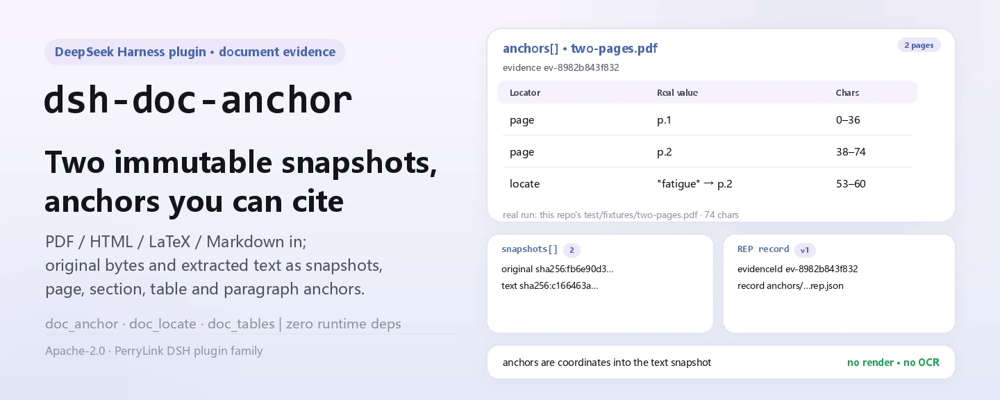
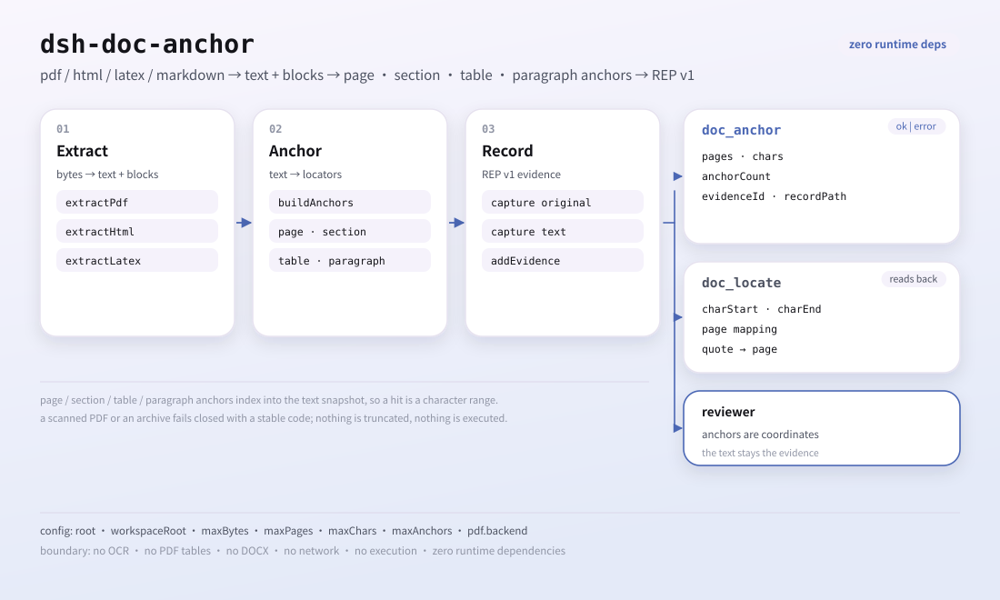
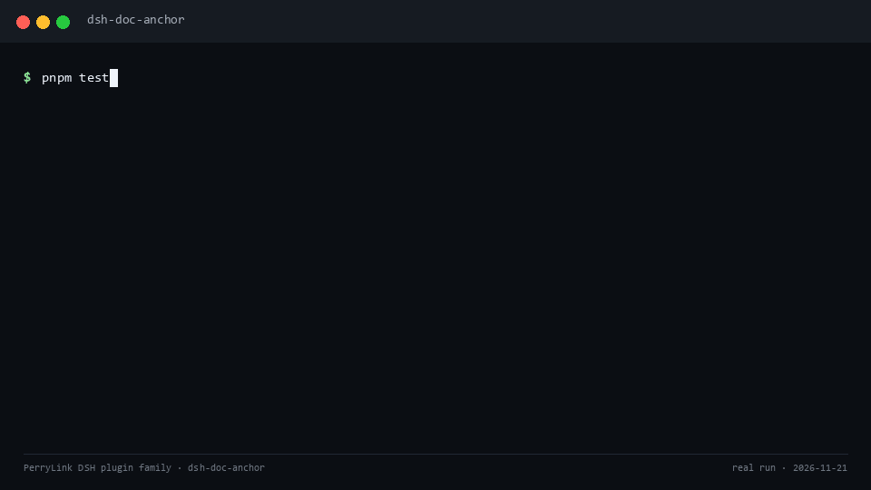

<div align="center">

<picture>
  <source media="(prefers-color-scheme: dark)" srcset="docs/assets/dsh-doc-anchor-hero-en-dark.webp">
  
</picture>

# dsh-doc-anchor

**Convierte documentos PDF / HTML / LaTeX / Markdown en superficies de evidencia localizables para DeepSeek Harness.**

*Sin lector, sin renderizador, sin traducción — solo coordenadas, snapshots inmutables y un registro de evidencia que cualquiera puede reverificar.*

[English](README.md) · [简体中文](README-zh.md) · [Español](README-es.md) · [Português](README-pt.md) · [हिन्दी](README-hi.md)

[](LICENSE)
[]()
[](https://github.com/topics/dsh-plugin)

</div>

---

## Qué hace

`dsh-doc-anchor` es el paso **PDF/HTML/LaTeX → evidencia** de la familia de plugins de investigación. Responde una pregunta: *¿dónde exactamente de este documento vive ese texto?*

- Dos snapshots inmutables por documento: los **bytes originales** y el **texto extraído**.
- Localizadores dentro del texto extraído: **rangos de página** (PDF), **secciones** (encabezados), **tablas**, **párrafos**, más offsets de carácter exactos.
- Un **registro de evidencia REP v1** (`@perrylink/dsh-research-core`) para que `claim-check`, `cite-verify`, `statcheck` y `research-report` puedan citar el documento sin confiar en un resumen.
- Ayudantes opcionales: `doc_locate` (encontrar una cita literal) y `doc_tables` (leer las rejillas de tabla de vuelta).

<picture>
  <source media="(prefers-color-scheme: dark)" srcset="docs/assets/dsh-doc-anchor-flow-v5-dark.svg">
  
</picture>

*Estructura: extraer → anclar → registrar; `doc_anchor` devuelve los localizadores, y `doc_locate` / `doc_tables` leen de vuelta los snapshots almacenados. Las etiquetas de token dentro del diagrama son los nombres reales de los extractores, del runtime y de las herramientas, así que la misma imagen sirve para los cinco idiomas.*

## Qué no hace

- **Sin OCR incluido.** Un PDF escaneado falla con un `parse_failed` explícito; un backend externo opcional (`pdf.backend: pdftotext | command`) puede ejecutar un extractor provisto por quien llama, pero no se empaqueta ningún binario y los fallos siguen siendo explícitos.
- **Sin reconstrucción de tablas PDF.** `doc_tables` lo dice en lugar de inventar una rejilla.
- **Sin renderizar, leer, traducir ni resumir.** El texto extraído es la capa de texto cruda, normalizada solo en espacios.
- **Sin ejecución de documentos.** `<script>`/`<style>` se descartan, las macros de LaTeX nunca se expanden, los archivos `\input` no se siguen.
- **Sin archivos comprimidos.** DOCX/ODT/EPUB/ZIP se rechazan por nombre — nada se descomprime, así que las zip bombs no tienen superficie.

## Compatibilidad

| | |
|---|---|
| DeepSeek Harness | **`dsh-v0.2.8-alpha.1`** (verificado el 2026-11-22); línea peer `>=0.2.8-0 <0.3.0 \|\| >=0.2.8-0 <0.3.0` |
| Node | `^22.19.0 \|\| >=24.9.0` (probado en `24.22.1`), solo ESM |
| Peers | `@perrylink/dsh-research-core ^0.1.0` (protocolo compartido), `@deepseek-ai/cordis ^4.0.5-alpha.1`, `@deepseek-ai/dsh-tools`, `@deepseek-ai/schemastery ^3.18.5-alpha.1` |
| Dependencias de runtime | **cero** |

El paquete core REP es un **peer obligatorio** (es el protocolo compartido, no un plugin hermano de funcionalidad). Instala ambos:

```sh
dsh plugin --profile <name> add @perrylink/dsh-research-core dsh-doc-anchor
dsh --profile <name> --dump-config | grep -E "dsh-research-core|dsh-doc-anchor"
dsh plugin --profile <name> remove dsh-doc-anchor
```

Cuando `ctx.researchEvidence` está montado, la evidencia va a ese almacén; en caso contrario, el plugin crea su propio `EvidenceStore` bajo `root`, así que también funciona solo.

## Herramientas

### `doc_anchor`

Acepta `path` **o** `content`.

| Parámetro | Tipo | Notas |
|---|---|---|
| `path` | string | relativo al workspace o absoluto; debe quedar dentro de `workspaceRoot` (se rechazan traversal y escapes por symlink) |
| `content` | string | texto del documento en línea (mutuamente excluyente con `path`) |
| `name` | string | nombre de archivo para detectar el tipo con contenido en línea |
| `mediaType` | enum | `application/pdf` · `text/html` · `text/x-latex` · `text/markdown` · `text/plain` |
| `title` | string | título de la evidencia (por defecto el nombre del archivo) |
| `persist` | boolean | `false` = dry run, sin snapshots ni registro |
| `maxAnchors` | integer | límite por llamada (tope duro 500, REP v1) |

Devuelve `{ ok, evidenceId, snapshotId, textSnapshotId, mediaType, pages, chars, anchorCount, truncated, anchors[], tableCount, warnings[], injectionSuspected, recordPath }`.

**Las anclas indexan dentro de `textSnapshotId`.** `kind` es `page` (con `page`), `section` (con `label: h1..h6`), `table` (con `value: t.N`) o `paragraph` (con `value: para.N`); cada ancla lleva `charStart`/`charEnd`.

### `doc_locate`

`{ query, evidenceId?, textSnapshotId?, maxResults?, ignoreCase? }` → `{ ok, count, hits[{charStart, charEnd, quote, page?}] }`.
Coincidencia exacta contra el texto extraído; `evidenceId` además mapea los aciertos a páginas de PDF. Cero aciertos es una respuesta normal.

### `doc_tables`

`{ evidenceId, maxRows? }` o `{ path, maxRows? }` → `{ ok, count, tables[{index, source, header?, rows, rowsTruncated, charStart, charEnd}], warnings[] }`.
El `<table>` de HTML y el `tabular` de LaTeX se analizan estructuralmente; las tablas PDF se reportan vacías con una advertencia.

### Códigos de error

`INVALID_INPUT` · `NOT_FOUND` · `NOT_A_FILE` · `PATH_ESCAPE` · `TOO_LARGE` · `PAGE_LIMIT` · `UNSUPPORTED_TYPE` · `PARSE_FAILED` · `EMPTY_DOCUMENT` · `STORE_ERROR` · `EVIDENCE_UNKNOWN`

Cada fallo es un `{ ok: false, error: { code, message } }` normalizado — ninguna excepción llega al modelo.

## Configuración

| Clave | Predeterminado | Significado |
|---|---|---|
| `enabled` | `true` | `false` no monta ninguna herramienta |
| `root` | `.doc-anchor` | raíz del almacén y de los registros (relativa al workspace) |
| `workspaceRoot` | `process.cwd()` | los caminos de los documentos deben resolverse dentro de ella |
| `maxBytes` | `104857600` | límite de bytes por documento (100 MiB) |
| `maxPages` | `500` | límite de páginas PDF — excederlo falla, nunca truncar |
| `maxChars` | `5000000` | límite de caracteres extraídos — excederlo falla |
| `maxAnchors` | `500` | límite de anclas por documento (tope duro del esquema 500) |
| `pdf.backend` | `builtin` | `builtin` (capa de texto), `pdftotext` o `command` (externo, vía `ctx.subprocess`) |
| `pdf.command` | — | argv para `command`; debe contener `{input}` (sin shell) |
| `pdf.timeoutMs` / `pdf.maxOutputBytes` | `30000` / `20971520` | límites de la invocación externa |
| `recordDir` | `anchors` | registros REP por documento bajo `<root>` |
| `persist` | `true` | escribe snapshots + registros |

Los valores inválidos fallan de forma explícita al montar (p. ej. `maxAnchors > 500`, `recordDir` con `..`).

## Límites de seguridad

- **Seguridad de rutas**: `path` se resuelve contra el workspace y luego se comprueba con `realpath`; `..`, rutas absolutas fuera y symlinks que apuntan fuera se rechazan con `PATH_ESCAPE`.
- **Tamaño/tiempo**: los límites de bytes, páginas y caracteres se aplican antes o durante el análisis; la entrada por encima del límite falla en lugar de truncarse.
- **Contenido no confiable**: los documentos son datos. Los scripts/estilos/iframes se descartan, LaTeX nunca se expande, y el texto con forma de instrucción levanta `prompt_injection_suspected` (advertencia acotada, solo metadatos) sin cambiar el comportamiento.
- **Sin red**: el plugin nunca descarga una URL. La captura remota pertenece a `dsh-cite-verify` / `dsh-research-report`.
- **Sin ejecución**: sin JavaScript de PDF, sin macros, sin referencias externas, sin extracción de archivos.

## Limitaciones conocidas (v0.1)

- **Los PDF escaneados** no tienen capa de texto → `PARSE_FAILED` con el backend integrado. El backend externo opcional es la vía de escape explícita; nunca se empaqueta y sus fallos se reportan, no se degradan en silencio.
- **Verificado:** 2026-11-10, poppler `pdftotext` 24.02.0 en Ubuntu 24.04, ambos backends `pdftotext` y `command`, un PDF sintético de dos páginas → anclas de página `p.1`/`p.2`, y un PDF sin texto falla de forma cerrada. El OCR en sí no se probó (no se instaló ningún binario de OCR; ninguno se empaqueta).
- **Fuentes CID sin `ToUnicode`** se renderizan como caracteres de reemplazo; se emite una advertencia por página.
- **Las tablas PDF** no se reconstruyen.
- **HTML** se escanea por etiquetas, no es un parser HTML5 completo; el marcado mal formado degrada con gracia pero puede perder estructura anidada.
- **LaTeX** es un escáner estructural: no se siguen los `\input`, las macros personalizadas no se expanden y solo se aplanan los comandos de texto comunes.
- **`.docx` / archivos comprimidos** se rechazan por diseño.

## Evaluación



*Animado: la ejecución real de `pnpm test` en este checkout (reejecutada el 2026-11-21). Las cinco pruebas de integración de `pdftotext` externo se omiten porque ese binario no está instalado aquí; la ruta integrada es lo que cubre el resto de la suite.*

- **59 pruebas / 6 archivos**: extracción (texto, markdown, HTML, LaTeX, PDF incl. FlateDecode, ToUnicode CMap, offsets multipágina, cifrado, límite de páginas, escaneos, offsets HTML cuando un documento empieza con una etiqueta de bloque), runtime (escapes de ruta, escape por symlink, límite de tamaño, persist=false, registros, borde de truncado por límite de anclas y validación, reanclaje sin conflicto de evidencia, offsets de locate insensibles a mayúsculas con Unicode), herramientas (esquemas, renders de éxito/fallo, locate/tables de extremo a extremo, entrada no soportada de `doc_tables`), contrato del paquete.
- **Los fixtures PDF sintéticos** se construyen en las pruebas (`test/fixtures/make-pdf.ts`) — no se versiona ningún PDF con derechos de autor, y "corpus de PDF del mundo real" es un hueco explícito en lugar de un resultado declarado.
- **No se declaran números de precision/recall** para este plugin; es infraestructura. Las métricas de detector pertenecen a `dsh-cite-verify` / `dsh-claim-check` / `dsh-statcheck`.

## Desarrollo

```sh
pnpm install
pnpm run typecheck
pnpm test
pnpm run build
pnpm run verify:package
```

## Licencia

Apache-2.0. Sin código de terceros en runtime.
