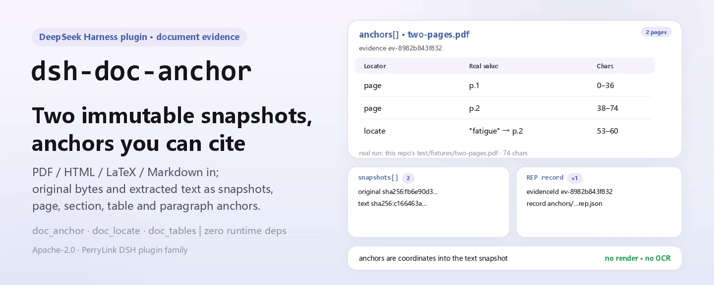
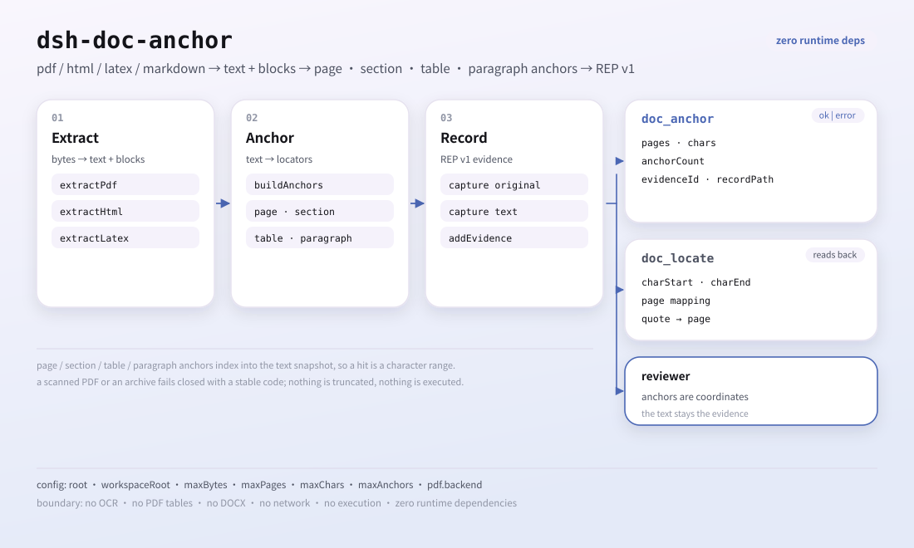
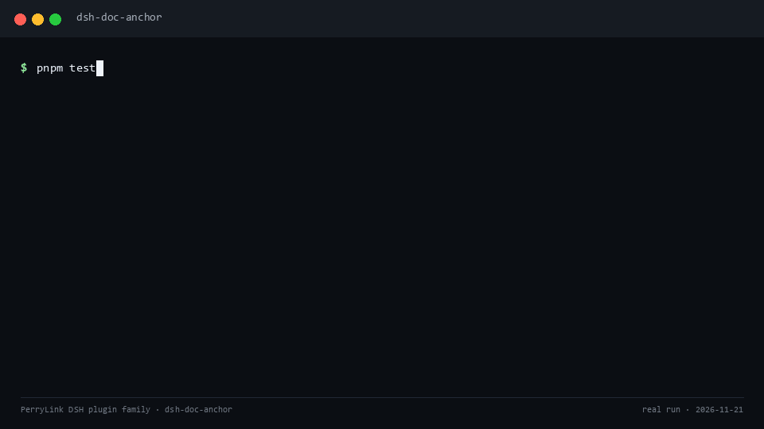

<div align="center">

<picture>
  <source media="(prefers-color-scheme: dark)" srcset="docs/assets/dsh-doc-anchor-hero-en-dark.webp">
  
</picture>

# dsh-doc-anchor

**PDF / HTML / LaTeX / Markdown दस्तावेज़ों को DeepSeek Harness के लिए ढूँढे जा सकने वाली एविडेंस सतहों में बदलता है।**

*कोई रीडर नहीं, कोई रेंडरर नहीं, कोई अनुवाद नहीं — बस निर्देशांक, अपरिवर्तनीय स्नैपशॉट, और एक एविडेंस रिकॉर्ड जिसे कोई भी दोबारा जाँच सकता है।*

[English](README.md) · [简体中文](README-zh.md) · [Español](README-es.md) · [Português](README-pt.md) · [हिन्दी](README-hi.md)

[](LICENSE)
[]()
[](https://github.com/topics/dsh-plugin)

</div>

---

## यह क्या करता है

`dsh-doc-anchor` रिसर्च प्लगइन परिवार का **PDF/HTML/LaTeX → एविडेंस** चरण है। यह एक सवाल का जवाब देता है: *इस दस्तावेज़ में वह पाठ ठीक कहाँ है?*

- प्रति दस्तावेज़ दो अपरिवर्तनीय स्नैपशॉट: **मूल बाइट्स** और **निकाला गया पाठ**।
- निकाले गए पाठ में लोकेटर: **पेज रेंज** (PDF), **सेक्शन** (शीर्षक), **टेबल**, **पैराग्राफ**, और सटीक अक्षर ऑफ़सेट।
- एक **REP v1 एविडेंस रिकॉर्ड** (`@perrylink/dsh-research-core`) ताकि `claim-check`, `cite-verify`, `statcheck` और `research-report` किसी सारांश पर भरोसा किए बिना दस्तावेज़ को उद्धृत कर सकें।
- वैकल्पिक सहायक: `doc_locate` (शब्दशः उद्धरण खोजना) और `doc_tables` (टेबल ग्रिड वापस पढ़ना)।


<picture>
  <source media="(prefers-color-scheme: dark)" srcset="docs/assets/dsh-doc-anchor-flow-v5-dark.svg">
  
</picture>

*संरचना: निकालना → एंकर करना → दर्ज करना; `doc_anchor` लोकेटर लौटाता है, और `doc_locate` / `doc_tables` संग्रहीत स्नैपशॉट वापस पढ़ते हैं। डायग्राम के अंदर टोकन लेबल असली एक्सट्रैक्टर, रनटाइम और टूल के नाम हैं, इसलिए एक ही चित्र पाँचों भाषाओं के लिए काम आता है।*

## यह क्या नहीं करता

- **कोई अंतर्निहित OCR नहीं।** स्कैन किया गया PDF स्पष्ट `parse_failed` के साथ विफल होता है; वैकल्पिक बाहरी बैकएंड (`pdf.backend: pdftotext | command`) कॉलर-प्रदत्त एक्सट्रैक्टर चला सकता है, पर कोई बाइनरी साथ नहीं आती और विफलताएँ ज़ोरदार बनी रहती हैं।
- **PDF टेबल पुनर्निर्माण नहीं।** `doc_tables` ग्रिड गढ़ने के बजाय यही बताता है।
- **रेंडर, पढ़ना, अनुवाद या सारांश नहीं।** निकाला गया पाठ कच्ची टेक्स्ट लेयर है, केवल स्पेस में सामान्यीकृत।
- **दस्तावेज़ निष्पादन नहीं।** `<script>`/`<style>` हटा दिए जाते हैं, LaTeX मैक्रो कभी विस्तारित नहीं होते, `\input` फ़ाइलें नहीं खोजी जातीं।
- **कोई आर्काइव नहीं।** DOCX/ODT/EPUB/ZIP नाम से अस्वीकार होते हैं — कुछ भी अनपैक नहीं होता, इसलिए zip bombs के लिए कोई सतह नहीं।

## संगतता

| | |
|---|---|
| DeepSeek Harness | **`dsh-v0.2.2-rc.4`** (2026-11-18 को सत्यापित); peer लाइन `>=0.2.1-0 <0.3.0 \|\| >=0.2.2-0 <0.3.0` |
| Node | `^22.19.0 \|\| >=24.9.0` (`24.22.1` पर परीक्षित), केवल ESM |
| Peers | `@perrylink/dsh-research-core ^0.1.0` (साझा प्रोटोकॉल), `@deepseek-ai/cordis ^4.0.5-alpha.1`, `@deepseek-ai/dsh-tools`, `@deepseek-ai/schemastery ^3.18.5-alpha.1` |
| रनटाइम निर्भरताएँ | **शून्य** |

REP core पैकेज एक **अनिवार्य peer** है (यह साझा प्रोटोकॉल है, कोई सहोदर फ़ीचर प्लगइन नहीं)। दोनों इंस्टॉल करें:

```sh
dsh plugin --profile <name> add @perrylink/dsh-research-core dsh-doc-anchor
dsh --profile <name> --dump-config | grep -E "dsh-research-core|dsh-doc-anchor"
dsh plugin --profile <name> remove dsh-doc-anchor
```

जब `ctx.researchEvidence` माउंट होता है, एविडेंस उसी स्टोर में जाता है; नहीं तो प्लगइन `root` के नीचे अपना `EvidenceStore` बनाता है, इसलिए यह अकेले भी काम करता है।

## टूल

### `doc_anchor`

`path` **या** `content` लेता है।

| पैरामीटर | प्रकार | नोट्स |
|---|---|---|
| `path` | string | workspace-सापेक्ष या निरपेक्ष; `workspaceRoot` के अंदर रहना चाहिए (traversal और symlink escape अस्वीकृत) |
| `content` | string | इनलाइन दस्तावेज़ पाठ (`path` के साथ परस्पर अनन्य) |
| `name` | string | इनलाइन सामग्री के साथ मीडिया-टाइप पहचानने के लिए फ़ाइल नाम |
| `mediaType` | enum | `application/pdf` · `text/html` · `text/x-latex` · `text/markdown` · `text/plain` |
| `title` | string | एविडेंस शीर्षक (डिफ़ॉल्ट: फ़ाइल नाम) |
| `persist` | boolean | `false` = dry run, कोई स्नैपशॉट और कोई रिकॉर्ड नहीं |
| `maxAnchors` | integer | प्रति-कॉल सीमा (कठोर सीमा 500, REP v1) |

लौटाता है `{ ok, evidenceId, snapshotId, textSnapshotId, mediaType, pages, chars, anchorCount, truncated, anchors[], tableCount, warnings[], injectionSuspected, recordPath }`.

**एंकर `textSnapshotId` में इंडेक्स करते हैं।** `kind` या तो `page` (साथ में `page`), `section` (साथ में `label: h1..h6`), `table` (साथ में `value: t.N`) या `paragraph` (साथ में `value: para.N`) है; हर एंकर `charStart`/`charEnd` लेकर आता है।

### `doc_locate`

`{ query, evidenceId?, textSnapshotId?, maxResults?, ignoreCase? }` → `{ ok, count, hits[{charStart, charEnd, quote, page?}] }`.
निकाले गए पाठ के विरुद्ध सटीक मिलान; `evidenceId` हिट को PDF पेजों पर भी मैप करता है। शून्य हिट एक सामान्य उत्तर है।

### `doc_tables`

`{ evidenceId, maxRows? }` या `{ path, maxRows? }` → `{ ok, count, tables[{index, source, header?, rows, rowsTruncated, charStart, charEnd}], warnings[] }`.
HTML `<table>` और LaTeX `tabular` संरचनात्मक रूप से पार्स होते हैं; PDF टेबल चेतावनी के साथ खाली रिपोर्ट होती हैं।

### त्रुटि कोड

`INVALID_INPUT` · `NOT_FOUND` · `NOT_A_FILE` · `PATH_ESCAPE` · `TOO_LARGE` · `PAGE_LIMIT` · `UNSUPPORTED_TYPE` · `PARSE_FAILED` · `EMPTY_DOCUMENT` · `STORE_ERROR` · `EVIDENCE_UNKNOWN`

हर विफलता एक सामान्यीकृत `{ ok: false, error: { code, message } }` है — कोई अपवाद मॉडल तक नहीं पहुँचता।

## कॉन्फ़िगरेशन

| कुंजी | डिफ़ॉल्ट | अर्थ |
|---|---|---|
| `enabled` | `true` | `false` कोई टूल माउंट नहीं करता |
| `root` | `.doc-anchor` | स्टोर और रिकॉर्ड का रूट (workspace-सापेक्ष) |
| `workspaceRoot` | `process.cwd()` | दस्तावेज़ पथ इसके अंदर ही हल होने चाहिए |
| `maxBytes` | `104857600` | प्रति-दस्तावेज़ बाइट सीमा (100 MiB) |
| `maxPages` | `500` | PDF पेज सीमा — पार करने पर विफल, कभी काटता नहीं |
| `maxChars` | `5000000` | निकाले गए अक्षरों की सीमा — पार करने पर विफल |
| `maxAnchors` | `500` | प्रति-दस्तावेज़ एंकर सीमा (स्कीमा की कठोर सीमा 500) |
| `pdf.backend` | `builtin` | `builtin` (टेक्स्ट लेयर), `pdftotext`, या `command` (बाहरी, `ctx.subprocess` के ज़रिए) |
| `pdf.command` | — | `command` के लिए argv; इसमें `{input}` होना चाहिए (कोई shell नहीं) |
| `pdf.timeoutMs` / `pdf.maxOutputBytes` | `30000` / `20971520` | बाहरी इनवोकेशन सीमाएँ |
| `recordDir` | `anchors` | `<root>` के नीचे प्रति-दस्तावेज़ REP रिकॉर्ड |
| `persist` | `true` | स्नैपशॉट + रिकॉर्ड लिखता है |

अमान्य मान माउंट पर ज़ोरदार विफल होते हैं (उदा. `maxAnchors > 500`, `..` वाला `recordDir`)।

## सुरक्षा सीमाएँ

- **पथ सुरक्षा**: `path` workspace के विरुद्ध हल होता है, फिर `realpath` से जाँचा जाता है; `..`, बाहर के निरपेक्ष पथ और बाहर इशारा करने वाले symlinks `PATH_ESCAPE` के साथ अस्वीकृत होते हैं।
- **आकार/समय**: बाइट, पेज और अक्षर सीमाएँ पार्सिंग से पहले/दौरान लागू होती हैं; सीमा से अधिक इनपुट काटे जाने के बजाय विफल होता है।
- **अविश्वसनीय सामग्री**: दस्तावेज़ डेटा हैं। स्क्रिप्ट/स्टाइल/iframe हटा दिए जाते हैं, LaTeX कभी विस्तारित नहीं होता, और निर्देश जैसा पाठ `prompt_injection_suspected` उठाता है (सीमित, केवल-मेटाडेटा चेतावनी) बिना व्यवहार बदले।
- **कोई नेटवर्क नहीं**: प्लगइन कभी URL नहीं लाता। रिमोट कैप्चर `dsh-cite-verify` / `dsh-research-report` का काम है।
- **कोई निष्पादन नहीं**: कोई PDF JavaScript नहीं, कोई मैक्रो नहीं, कोई बाहरी संदर्भ नहीं, कोई आर्काइव निष्कर्षण नहीं।

## ज्ञात सीमाएँ (v0.1)

- **स्कैन किए गए PDF** में कोई टेक्स्ट लेयर नहीं होती → अंतर्निहित बैकएंड के साथ `PARSE_FAILED`। वैकल्पिक बाहरी बैकएंड स्पष्ट एस्केप हैच है; यह कभी साथ नहीं आता और इसकी विफलताएँ रिपोर्ट होती हैं, चुपचाप कमज़ोर नहीं की जातीं।
- **सत्यापित:** 2026-11-10, Ubuntu 24.04 पर poppler `pdftotext` 24.02.0, दोनों `pdftotext` और `command` बैकएंड, दो-पेज का सिंथेटिक PDF → `p.1`/`p.2` पेज एंकर, और बिना टेक्स्ट वाला PDF बंद रूप में विफल होता है। OCR स्वयं परीक्षित नहीं हुआ (कोई OCR बाइनरी इंस्टॉल नहीं थी; कोई साथ नहीं आती)।
- **`ToUnicode` के बिना CID फ़ॉन्ट** प्रतिस्थापन अक्षरों के रूप में रेंडर होते हैं; प्रति पेज एक चेतावनी दी जाती है।
- **PDF टेबल** पुनर्निर्मित नहीं होतीं।
- **HTML** टैग-स्कैन है, पूरा HTML5 पार्सर नहीं; विकृत मार्कअप शालीनता से कमज़ोर होता है पर नेस्टेड संरचना खो सकता है।
- **LaTeX** एक संरचनात्मक स्कैनर है: `\input` नहीं खोजा जाता, कस्टम मैक्रो विस्तारित नहीं होते, और केवल सामान्य टेक्स्ट कमांड फ़्लैट किए जाते हैं।
- **`.docx` / आर्काइव** डिज़ाइन से अस्वीकृत हैं।

## मूल्यांकन



*एनिमेटेड: इस चेकआउट में `pnpm test` का असली रन (2026-11-21 को दोबारा चलाया गया)। पाँच बाहरी `pdftotext` इंटीग्रेशन टेस्ट छोड़े गए क्योंकि वह बाइनरी यहाँ इंस्टॉल नहीं है; बाकी सूट अंतर्निहित पथ को कवर करती है।*


- **59 टेस्ट / 6 फ़ाइलें**: एक्सट्रैक्शन (टेक्स्ट, markdown, HTML, LaTeX, PDF incl. FlateDecode, ToUnicode CMap, मल्टी-पेज ऑफ़सेट, एन्क्रिप्टेड, पेज सीमा, स्कैन, दस्तावेज़ के ब्लॉक टैग से शुरू होने पर HTML ऑफ़सेट), रनटाइम (पथ एस्केप, symlink एस्केप, आकार सीमा, persist=false, रिकॉर्ड, एंकर-सीमा ट्रंकेशन सीमा और वैलिडेशन, एविडेंस विरोध के बिना पुनः-एंकरिंग, Unicode केस-असंवेदनशील locate ऑफ़सेट), टूल (स्कीमा, सफलता/विफलता रेंडर, end-to-end locate/tables, असमर्थित `doc_tables` इनपुट), पैकेज अनुबंध।
- **सिंथेटिक PDF फ़िक्सचर** टेस्ट में बनाए जाते हैं (`test/fixtures/make-pdf.ts`) — कोई कॉपीराइटेड PDF कमिट नहीं होता, और "वास्तविक दुनिया का PDF कॉर्पस" दावा किए गए परिणाम के बजाय एक स्पष्ट अंतराल है।
- इस प्लगइन के लिए **कोई precision/recall संख्या** दावा नहीं की जाती; यह इन्फ्रास्ट्रक्चर है। डिटेक्टर मीट्रिक्स `dsh-cite-verify` / `dsh-claim-check` / `dsh-statcheck` के पास हैं।

## डेवलपमेंट

```sh
pnpm install
pnpm run typecheck
pnpm test
pnpm run build
pnpm run verify:package
```

## लाइसेंस

Apache-2.0. रनटाइम में कोई तृतीय-पक्ष कोड नहीं।
