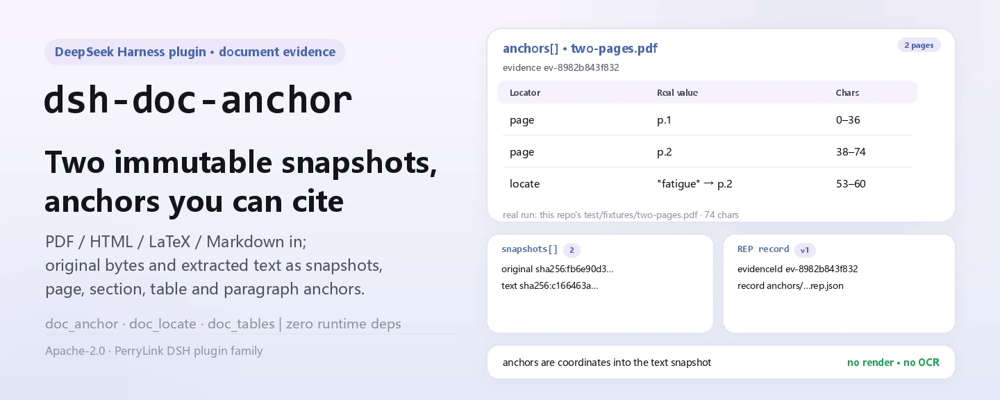
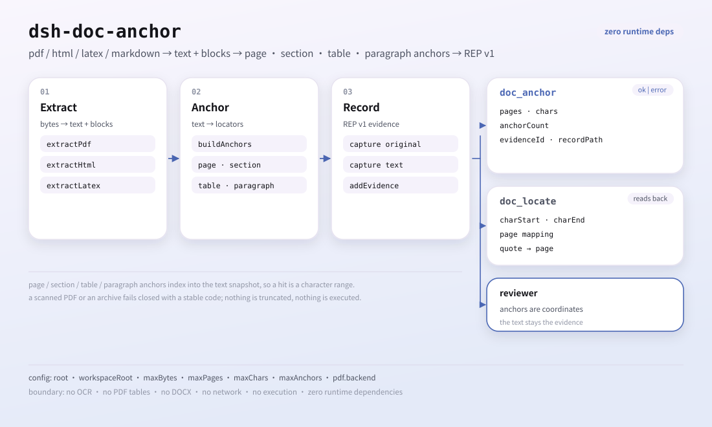
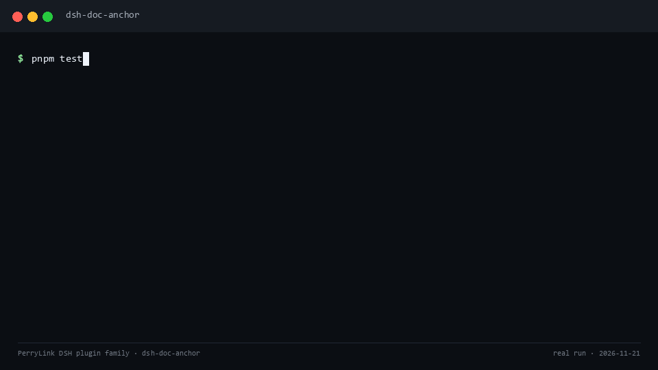

<div align="center">

<picture>
  <source media="(prefers-color-scheme: dark)" srcset="docs/assets/dsh-doc-anchor-hero-en-dark.webp">
  
</picture>

# dsh-doc-anchor

**Transforma documentos PDF / HTML / LaTeX / Markdown em superfícies de evidência localizáveis para o DeepSeek Harness.**

*Sem leitor, sem renderizador, sem tradução — apenas coordenadas, snapshots imutáveis e um registro de evidência que qualquer pessoa pode reverificar.*

[English](README.md) · [简体中文](README-zh.md) · [Español](README-es.md) · [Português](README-pt.md) · [हिन्दी](README-hi.md)

[](LICENSE)
[]()
[](https://github.com/topics/dsh-plugin)

</div>

---

## O que faz

`dsh-doc-anchor` é o passo **PDF/HTML/LaTeX → evidência** da família de plugins de pesquisa. Ele responde a uma pergunta: *onde exatamente neste documento esse texto está?*

- Dois snapshots imutáveis por documento: os **bytes originais** e o **texto extraído**.
- Localizadores no texto extraído: **intervalos de página** (PDF), **seções** (cabeçalhos), **tabelas**, **parágrafos**, além de offsets exatos de caractere.
- Um **registro de evidência REP v1** (`@perrylink/dsh-research-core`) para que `claim-check`, `cite-verify`, `statcheck` e `research-report` possam citar o documento sem confiar em um resumo.
- Ajudantes opcionais: `doc_locate` (encontrar uma citação literal) e `doc_tables` (ler as grades de tabela de volta).

<picture>
  <source media="(prefers-color-scheme: dark)" srcset="docs/assets/dsh-doc-anchor-flow-v5-dark.svg">
  
</picture>

*Estrutura: extrair → ancorar → registrar; `doc_anchor` devolve os localizadores, e `doc_locate` / `doc_tables` leem de volta os snapshots armazenados. Os rótulos de token dentro do diagrama são os nomes reais dos extratores, do runtime e das ferramentas, então a mesma imagem serve aos cinco idiomas.*

## O que não faz

- **Sem OCR embutido.** Um PDF escaneado falha com um `parse_failed` explícito; um backend externo opcional (`pdf.backend: pdftotext | command`) pode executar um extrator fornecido por quem chama, mas nenhum binário é empacotado e as falhas continuam explícitas.
- **Sem reconstrução de tabelas PDF.** `doc_tables` diz isso em vez de inventar uma grade.
- **Sem renderizar, ler, traduzir ou resumir.** O texto extraído é a camada de texto bruta, normalizada apenas em espaços.
- **Sem execução de documentos.** `<script>`/`<style>` são descartados, macros de LaTeX nunca são expandidas, arquivos `\input` não são seguidos.
- **Sem arquivos compactados.** DOCX/ODT/EPUB/ZIP são rejeitados pelo nome — nada é descompactado, então zip bombs não têm superfície.

## Compatibilidade

| | |
|---|---|
| DeepSeek Harness | **`dsh-v0.2.5-alpha.1`** (verificado em 2026-11-22); linha peer `>=0.2.5-0 <0.3.0 \|\| >=0.2.5-0 <0.3.0` |
| Node | `^22.19.0 \|\| >=24.9.0` (testado em `24.22.1`), somente ESM |
| Peers | `@perrylink/dsh-research-core ^0.1.0` (protocolo compartilhado), `@deepseek-ai/cordis ^4.0.5-alpha.1`, `@deepseek-ai/dsh-tools`, `@deepseek-ai/schemastery ^3.18.5-alpha.1` |
| Dependências de runtime | **zero** |

O pacote core REP é um **peer obrigatório** (é o protocolo compartilhado, não um plugin irmão de funcionalidade). Instale os dois:

```sh
dsh plugin --profile <name> add @perrylink/dsh-research-core dsh-doc-anchor
dsh --profile <name> --dump-config | grep -E "dsh-research-core|dsh-doc-anchor"
dsh plugin --profile <name> remove dsh-doc-anchor
```

Quando `ctx.researchEvidence` está montado, a evidência vai para esse armazenamento; caso contrário, o plugin cria seu próprio `EvidenceStore` sob `root`, então também funciona sozinho.

## Ferramentas

### `doc_anchor`

Aceita `path` **ou** `content`.

| Parâmetro | Tipo | Notas |
|---|---|---|
| `path` | string | relativo ao workspace ou absoluto; deve ficar dentro de `workspaceRoot` (traversal e escapes por symlink rejeitados) |
| `content` | string | texto do documento em linha (mutuamente exclusivo com `path`) |
| `name` | string | nome de arquivo para detectar o tipo com conteúdo em linha |
| `mediaType` | enum | `application/pdf` · `text/html` · `text/x-latex` · `text/markdown` · `text/plain` |
| `title` | string | título da evidência (padrão: o nome do arquivo) |
| `persist` | boolean | `false` = dry run, sem snapshots e sem registro |
| `maxAnchors` | integer | limite por chamada (teto rígido 500, REP v1) |

Devolve `{ ok, evidenceId, snapshotId, textSnapshotId, mediaType, pages, chars, anchorCount, truncated, anchors[], tableCount, warnings[], injectionSuspected, recordPath }`.

**As âncoras indexam dentro de `textSnapshotId`.** `kind` é `page` (com `page`), `section` (com `label: h1..h6`), `table` (com `value: t.N`) ou `paragraph` (com `value: para.N`); toda âncora carrega `charStart`/`charEnd`.

### `doc_locate`

`{ query, evidenceId?, textSnapshotId?, maxResults?, ignoreCase? }` → `{ ok, count, hits[{charStart, charEnd, quote, page?}] }`.
Correspondência exata contra o texto extraído; `evidenceId` também mapeia acertos para páginas de PDF. Zero acertos é uma resposta normal.

### `doc_tables`

`{ evidenceId, maxRows? }` ou `{ path, maxRows? }` → `{ ok, count, tables[{index, source, header?, rows, rowsTruncated, charStart, charEnd}], warnings[] }`.
O `<table>` de HTML e o `tabular` de LaTeX são analisados estruturalmente; tabelas PDF são reportadas vazias com um aviso.

### Códigos de erro

`INVALID_INPUT` · `NOT_FOUND` · `NOT_A_FILE` · `PATH_ESCAPE` · `TOO_LARGE` · `PAGE_LIMIT` · `UNSUPPORTED_TYPE` · `PARSE_FAILED` · `EMPTY_DOCUMENT` · `STORE_ERROR` · `EVIDENCE_UNKNOWN`

Cada falha é um `{ ok: false, error: { code, message } }` normalizado — nenhuma exceção chega ao modelo.

## Configuração

| Chave | Padrão | Significado |
|---|---|---|
| `enabled` | `true` | `false` não monta nenhuma ferramenta |
| `root` | `.doc-anchor` | raiz do armazenamento e dos registros (relativa ao workspace) |
| `workspaceRoot` | `process.cwd()` | os caminhos dos documentos devem resolver dentro dela |
| `maxBytes` | `104857600` | limite de bytes por documento (100 MiB) |
| `maxPages` | `500` | limite de páginas PDF — exceder falha, nunca trunca |
| `maxChars` | `5000000` | limite de caracteres extraídos — exceder falha |
| `maxAnchors` | `500` | limite de âncoras por documento (teto rígido do esquema 500) |
| `pdf.backend` | `builtin` | `builtin` (camada de texto), `pdftotext` ou `command` (externo, via `ctx.subprocess`) |
| `pdf.command` | — | argv para `command`; deve conter `{input}` (sem shell) |
| `pdf.timeoutMs` / `pdf.maxOutputBytes` | `30000` / `20971520` | limites da invocação externa |
| `recordDir` | `anchors` | registros REP por documento sob `<root>` |
| `persist` | `true` | grava snapshots + registros |

Valores inválidos falham de forma explícita ao montar (p. ex. `maxAnchors > 500`, `recordDir` contendo `..`).

## Limites de segurança

- **Segurança de caminhos**: `path` é resolvido contra o workspace e então verificado com `realpath`; `..`, caminhos absolutos fora e symlinks apontando para fora são rejeitados com `PATH_ESCAPE`.
- **Tamanho/tempo**: limites de bytes, páginas e caracteres são aplicados antes/durante o parsing; entrada acima do limite falha em vez de ser truncada.
- **Conteúdo não confiável**: documentos são dados. Scripts/estilos/iframes são descartados, LaTeX nunca é expandido, e texto com aparência de instrução levanta `prompt_injection_suspected` (aviso limitado, apenas metadados) sem mudar o comportamento.
- **Sem rede**: o plugin nunca busca uma URL. A captura remota pertence a `dsh-cite-verify` / `dsh-research-report`.
- **Sem execução**: sem JavaScript de PDF, sem macros, sem referências externas, sem extração de arquivos.

## Limitações conhecidas (v0.1)

- **PDFs escaneados** não têm camada de texto → `PARSE_FAILED` com o backend embutido. O backend externo opcional é a válvula de escape explícita; nunca é empacotado e suas falhas são reportadas, não degradadas em silêncio.
- **Verificado:** 2026-11-10, poppler `pdftotext` 24.02.0 no Ubuntu 24.04, ambos os backends `pdftotext` e `command`, um PDF sintético de duas páginas → âncoras de página `p.1`/`p.2`, e um PDF sem texto falha de forma fechada. O OCR em si não foi testado (nenhum binário de OCR foi instalado; nenhum é empacotado).
- **Fontes CID sem `ToUnicode`** renderizam como caracteres de substituição; um aviso é emitido por página.
- **Tabelas PDF** não são reconstruídas.
- **HTML** é escaneado por tags, não é um parser HTML5 completo; marcação malformada degrada com elegância mas pode perder estrutura aninhada.
- **LaTeX** é um scanner estrutural: `\input` não é seguido, macros personalizadas não são expandidas, e apenas comandos de texto comuns são achatados.
- **`.docx` / arquivos compactados** são rejeitados por design.

## Avaliação



*Animado: a execução real de `pnpm test` neste checkout (reexecutada em 2026-11-21). Os cinco testes de integração de `pdftotext` externo são ignorados porque esse binário não está instalado aqui; o caminho embutido é o que o restante da suíte cobre.*

- **59 testes / 6 arquivos**: extração (texto, markdown, HTML, LaTeX, PDF incl. FlateDecode, ToUnicode CMap, offsets multipágina, criptografado, limite de páginas, scans, offsets HTML quando um documento começa com uma tag de bloco), runtime (escapes de caminho, escape por symlink, limite de tamanho, persist=false, registros, limite de truncamento por âncoras e validação, reancoragem sem conflito de evidência, offsets de locate insensíveis a maiúsculas com Unicode), ferramentas (esquemas, renders de sucesso/falha, locate/tables de ponta a ponta, entrada não suportada de `doc_tables`), contrato do pacote.
- **Fixtures PDF sintéticos** são construídos nos testes (`test/fixtures/make-pdf.ts`) — nenhum PDF com direitos autorais é versionado, e "corpus de PDF do mundo real" é uma lacuna explícita em vez de um resultado declarado.
- **Nenhum número de precision/recall** é declarado para este plugin; ele é infraestrutura. Métricas de detector pertencem a `dsh-cite-verify` / `dsh-claim-check` / `dsh-statcheck`.

## Desenvolvimento

```sh
pnpm install
pnpm run typecheck
pnpm test
pnpm run build
pnpm run verify:package
```

## Licença

Apache-2.0. Sem código de terceiros em runtime.
