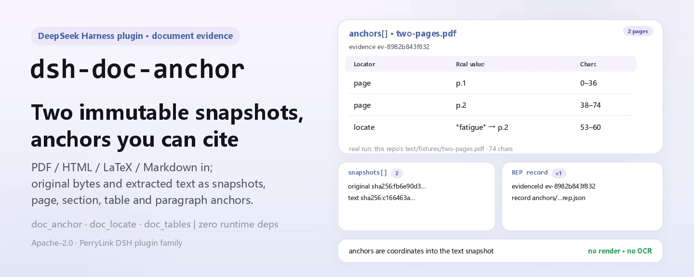
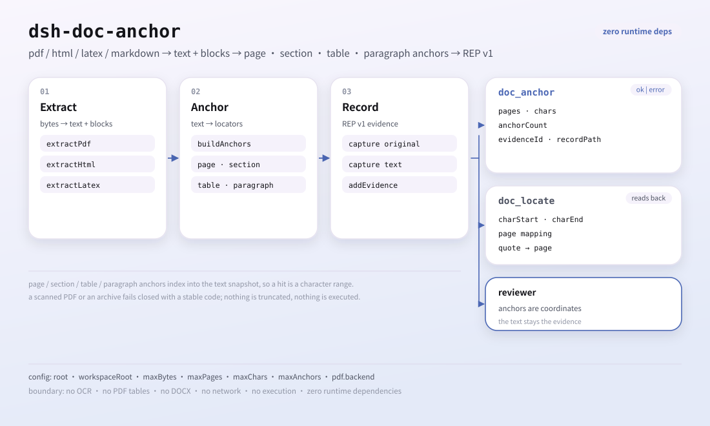
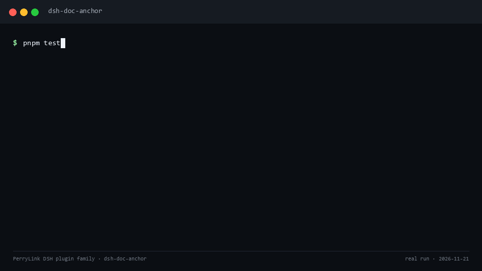

<div align="center">

<picture>
  <source media="(prefers-color-scheme: dark)" srcset="docs/assets/dsh-doc-anchor-hero-en-dark.webp">
  
</picture>

# dsh-doc-anchor

**Turn PDF / HTML / LaTeX / Markdown documents into locatable evidence surfaces for DeepSeek Harness.**

*No reader, no renderer, no translation — just coordinates, immutable snapshots, and an evidence record anyone can re-check.*

[简体中文](README-zh.md) · [Español](README-es.md) · [Português](README-pt.md) · [हिन्दी](README-hi.md)

[](LICENSE)
[]()
[](https://github.com/topics/dsh-plugin)

</div>

---

## What it does

`dsh-doc-anchor` is the **PDF/HTML/LaTeX → evidence** step of the research plugin family. It answers one question: *where exactly in this document does that text live?*

- Two immutable snapshots per document: the **original bytes** and the **extracted text**.
- Locators into the extracted text: **page ranges** (PDF), **sections** (headings), **tables**, **paragraphs**, plus exact char offsets.
- A **REP v1 evidence record** (`@perrylink/dsh-research-core`) so `claim-check`, `cite-verify`, `statcheck` and `research-report` can cite the document without trusting a summary.
- Optional helpers: `doc_locate` (find a verbatim quote), `doc_tables` (read table grids back).

<picture>
  <source media="(prefers-color-scheme: dark)" srcset="docs/assets/dsh-doc-anchor-flow-v5-dark.svg">
  
</picture>

*Structure: extract → anchor → record; `doc_anchor` returns the locators, and `doc_locate` / `doc_tables` read the stored snapshots back. The token labels inside the diagram are the real extractor, runtime and tool names, so the same picture serves all five languages.*

## What it does not do

- **No bundled OCR.** A scanned PDF fails with an explicit `parse_failed`; an optional external backend (`pdf.backend: pdftotext | command`) can run a caller-provided extractor, but no binary is bundled and failures stay loud.
- **No PDF table reconstruction.** `doc_tables` says so instead of inventing a grid.
- **No rendering, reading, translating or summarising.** Extracted text is the raw text layer, normalized only in whitespace.
- **No document execution.** `<script>`/`<style>` are dropped, LaTeX macros are never expanded, `\input` files are not followed.
- **No archives.** DOCX/ODT/EPUB/ZIP are rejected by name — nothing is unpacked, so zip bombs have no surface.

## Compatibility

| | |
|---|---|
| DeepSeek Harness | **`dsh-v0.2.5-alpha.1`** (verified 2026-11-22); peer line `>=0.2.5-0 <0.3.0 \|\| >=0.2.5-0 <0.3.0` |
| Node | `^22.19.0 \|\| >=24.9.0` (tested on `24.22.1`), ESM only |
| Peers | `@perrylink/dsh-research-core ^0.1.0` (shared protocol), `@deepseek-ai/cordis ^4.0.5-alpha.1`, `@deepseek-ai/dsh-tools`, `@deepseek-ai/schemastery ^3.18.5-alpha.1` |
| Runtime dependencies | **zero** |

The REP core package is a **required peer** (it is the shared protocol, not a sibling feature plugin). Install both:

```sh
dsh plugin --profile <name> add @perrylink/dsh-research-core dsh-doc-anchor
dsh --profile <name> --dump-config | grep -E "dsh-research-core|dsh-doc-anchor"
dsh plugin --profile <name> remove dsh-doc-anchor
```

When `ctx.researchEvidence` is mounted, evidence goes into that store; otherwise the plugin creates its own `EvidenceStore` under `root`, so it also works alone.

## Tools

### `doc_anchor`

Takes `path` **or** `content`.

| Parameter | Type | Notes |
|---|---|---|
| `path` | string | workspace-relative or absolute; must stay inside `workspaceRoot` (traversal + symlink escapes rejected) |
| `content` | string | inline document text (mutually exclusive with `path`) |
| `name` | string | file name for media-type detection with inline content |
| `mediaType` | enum | `application/pdf` · `text/html` · `text/x-latex` · `text/markdown` · `text/plain` |
| `title` | string | evidence title (defaults to the file name) |
| `persist` | boolean | `false` = dry run, no snapshots and no record |
| `maxAnchors` | integer | per-call cap (hard cap 500, REP v1) |

Returns `{ ok, evidenceId, snapshotId, textSnapshotId, mediaType, pages, chars, anchorCount, truncated, anchors[], tableCount, warnings[], injectionSuspected, recordPath }`.

**Anchors index into `textSnapshotId`.** `kind` is `page` (with `page`), `section` (with `label: h1..h6`), `table` (with `value: t.N`), or `paragraph` (with `value: para.N`); every anchor carries `charStart`/`charEnd`.

### `doc_locate`

`{ query, evidenceId?, textSnapshotId?, maxResults?, ignoreCase? }` → `{ ok, count, hits[{charStart, charEnd, quote, page?}] }`.
Exact match against the extracted text; `evidenceId` also maps hits to PDF pages. Zero hits is a normal answer.

### `doc_tables`

`{ evidenceId, maxRows? }` or `{ path, maxRows? }` → `{ ok, count, tables[{index, source, header?, rows, rowsTruncated, charStart, charEnd}], warnings[] }`.
HTML `<table>` and LaTeX `tabular` are parsed structurally; PDF tables report empty with a warning.

### Error codes

`INVALID_INPUT` · `NOT_FOUND` · `NOT_A_FILE` · `PATH_ESCAPE` · `TOO_LARGE` · `PAGE_LIMIT` · `UNSUPPORTED_TYPE` · `PARSE_FAILED` · `EMPTY_DOCUMENT` · `STORE_ERROR` · `EVIDENCE_UNKNOWN`

Every failure is a normalised `{ ok: false, error: { code, message } }` — no exception reaches the model.

## Configuration

| Key | Default | Meaning |
|---|---|---|
| `enabled` | `true` | `false` mounts no tools |
| `root` | `.doc-anchor` | store + records root (workspace-relative) |
| `workspaceRoot` | `process.cwd()` | document paths must resolve inside it |
| `maxBytes` | `104857600` | per-document byte cap (100 MiB) |
| `maxPages` | `500` | PDF page cap — exceeding fails, never truncates |
| `maxChars` | `5000000` | extracted-character cap — exceeding fails |
| `maxAnchors` | `500` | per-document anchor cap (schema hard cap 500) |
| `pdf.backend` | `builtin` | `builtin` (text layer), `pdftotext`, or `command` (external, via `ctx.subprocess`) |
| `pdf.command` | — | argv for `command`; must contain `{input}` (no shell) |
| `pdf.timeoutMs` / `pdf.maxOutputBytes` | `30000` / `20971520` | external invocation caps |
| `recordDir` | `anchors` | per-document REP records under `<root>` |
| `persist` | `true` | write snapshots + records |

Invalid values fail loud at mount (e.g. `maxAnchors > 500`, `recordDir` containing `..`).

## Security boundaries

- **Path safety**: `path` is resolved against the workspace, then `realpath`-checked; `..`, absolute paths outside, and symlinks pointing outside are rejected with `PATH_ESCAPE`.
- **Size/time**: byte, page and character caps are enforced before/while parsing; over-limit input fails instead of being truncated.
- **Untrusted content**: documents are data. Scripts/styles/iframes are dropped, LaTeX is never expanded, and instruction-like text raises `prompt_injection_suspected` (bounded, metadata-only warning) without changing behaviour.
- **No network**: the plugin never fetches a URL. Remote capture belongs to `dsh-cite-verify` / `dsh-research-report`.
- **No execution**: no PDF JavaScript, no macros, no external references, no archive extraction.

## Known limitations (v0.1)

- **Scanned PDFs** have no text layer → `PARSE_FAILED` with the built-in backend. The optional external backend is the explicit escape hatch; it is never bundled and its failures are reported, not silently degraded.
- **Verified:** 2026-11-10, poppler `pdftotext` 24.02.0 on Ubuntu 24.04, both `pdftotext` and `command` backends, a two-page synthetic PDF → `p.1`/`p.2` page anchors, and a no-text PDF fails closed. OCR itself was not tested (no OCR binary was installed; none is bundled).
- **CID fonts without `ToUnicode`** render as replacement characters; a warning is emitted per page.
- **PDF tables** are not reconstructed.
- **HTML** is tag-scanned, not a full HTML5 parser; malformed markup degrades gracefully but may lose nested structure.
- **LaTeX** is a structural scanner: `\input` is not followed, custom macros are not expanded, and only common text commands are flattened.
- **`.docx` / archives** are rejected by design.

## Evaluation



*Animated: the real `pnpm test` run in this checkout (re-run 2026-11-21). The five external-`pdftotext` integration tests are skipped because that binary is not installed here; the built-in path is what the rest of the suite covers.*

- **59 tests / 6 files**: extraction (text, markdown, HTML, LaTeX, PDF incl. FlateDecode, ToUnicode CMap, multi-page offsets, encrypted, page cap, scans, HTML offsets when a document starts with a block tag), runtime (path escapes, symlink escape, size cap, persist=false, records, anchor-cap truncation boundary and validation, re-anchoring without an evidence conflict, Unicode case-insensitive locate offsets), tools (schemas, success/failure renders, end-to-end locate/tables, unsupported `doc_tables` input), package contract.
- **Synthetic PDF fixtures** are built in tests (`test/fixtures/make-pdf.ts`) — no copyrighted PDF is committed, and "real-world PDF corpus" is an explicit gap rather than a claimed result.
- **No precision/recall numbers** are claimed for this plugin; it is infrastructure. Detector metrics belong to `dsh-cite-verify` / `dsh-claim-check` / `dsh-statcheck`.

## Development

```sh
pnpm install
pnpm run typecheck
pnpm test
pnpm run build
pnpm run verify:package
```

## License

Apache-2.0. No third-party runtime code.
